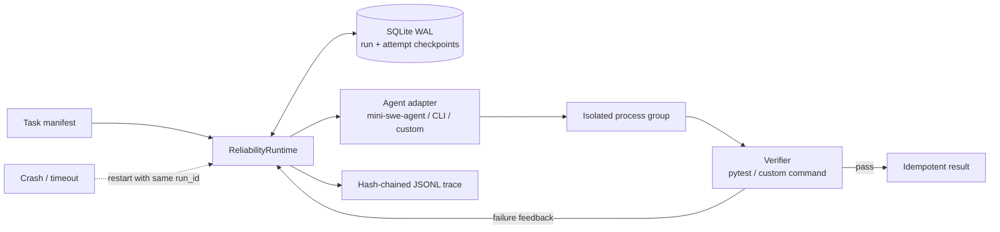

# Agent Reliability Harness

[](https://github.com/Aurora491/agent-reliability-harness/actions/workflows/ci.yml)
[](https://www.python.org/)
[](LICENSE)

Coding agents fail as systems even when the model can write a correct patch: the controller crashes,
retries replay side effects, child processes outlive timeouts, and the final score hides the failure path.
**Agent Reliability Harness (ARH)** adds crash-safe checkpoints, bounded recovery, process-group cleanup,
and tamper-evident traces around any agent adapter.

## 30-second crash-recovery demo

No API key, model, package install, or network connection is required:

```bash
git clone https://github.com/Aurora491/agent-reliability-harness.git
cd agent-reliability-harness
python scripts/recovery_demo.py
```

The demo checkpoints attempt 1, injects a controller interruption, creates a **new** runtime instance,
resumes at attempt 2, verifies the artifact, and validates the complete hash chain:

```json
{"crash_observed": true, "status": "completed", "resumed": true, "attempts": 2, "trace_valid": true}
```

## Architecture



| Reproducible experiment | Baseline | Hardened | Raw artifacts |
| --- | ---: | ---: | --- |
| Deterministic first-attempt crash, 1,000 tasks | 800/1,000 (80%) | **1,000/1,000 (100%)** | [JSON](results/fault-benchmark-1000.json) |
| DeepSeek on 50 public MBPP tasks | 45/50 (90%) | **49/50 (98%)** | [JSON](results/deepseek-ablation/summary.json) · [config](benchmark/deepseek_agent.yaml) |

The deterministic benchmark isolates runtime recovery from model quality. The MBPP ablation shows the
quality/cost trade-off of one verifier-feedback retry: +8 percentage points, with +14.3% tokens. These
results are local experimental evidence, not claims about every model or workload.

## What is implemented

- **Crash-safe state:** SQLite WAL persists runs and attempts; restarting with the same `run_id` resumes
  at the next unfinished attempt and returns completed runs without re-invoking the agent.
- **Bounded recovery:** failed verifier output becomes structured feedback for the next attempt.
- **Idempotent effects:** a unique `(run_id, effect_key)` ledger prevents duplicate publication.
- **Process-tree cleanup:** external commands run in a new process group; timeout sends `TERM` and then
  `KILL` to the whole group so descendants do not survive.
- **Auditable execution:** append-only JSONL events carry `previous_hash` and `event_hash`; edits and
  broken chains are detected by `arh verify-trace`.
- **Deterministic fault injection:** faults can be placed before or after an attempt to compare baseline
  and hardened policies under the same failure schedule.

## Crash-recovery trace

A committed [eight-event trace](docs/examples/crash-recovery-trace.jsonl) captures one complete recovery:

```text
run_started(resumed=false) -> attempt_started(1) -> attempt_failed(KeyboardInterrupt)
-> run_started(resumed=true) -> attempt_started(2) -> agent_finished
-> verification_finished(passed=true) -> run_completed
```

Verify it independently after installing the package:

```bash
python -m venv .venv
.venv/bin/pip install -e .
.venv/bin/arh verify-trace docs/examples/crash-recovery-trace.jsonl
```

## Reproduce the experiments

### Deterministic fault benchmark

```bash
python scripts/fault_benchmark.py \
  --tasks 1000 \
  --fault-every 5 \
  --output results/fault-benchmark-1000.json
```

This injects a crash into attempt 1 of every fifth task. The one-attempt baseline cannot recover; the
two-attempt runtime must resume without replaying the publish effect. Latency in the JSON measures only
local SQLite/trace orchestration with a fake agent, not model or end-to-end latency.

### Public MBPP tasks with DeepSeek

Workspaces are generated on demand and are not committed:

```bash
.venv/bin/pip install -e ".[dev,deepseek]"
python scripts/import_mbpp.py --count 50
export DEEPSEEK_API_KEY="your-local-key"
python scripts/deepseek_ablation.py \
  --mini-executable /path/to/mini \
  --limit 50 \
  --budget-usd 6 \
  --output results/deepseek-ablation
```

Configuration: `deepseek/deepseek-flash`, thinking disabled, temperature 0, step limit 6. The baseline
gets one attempt; the hardened condition gets one retry with verifier output. The script reads the key
only from the environment and enforces a peak-price budget. Task prompts and relative workspace paths
are in [`benchmark/tasks.json`](benchmark/tasks.json).

## Development and CI

```bash
python -m venv .venv
.venv/bin/pip install -e ".[dev]"
.venv/bin/ruff check .
.venv/bin/pytest -q
python scripts/public_repo_audit.py
```

GitHub Actions runs lint, tests, the public-tree audit, the crash-recovery demo, trace verification, and
a 100-task fault benchmark. The generated demo trace and benchmark JSON are uploaded as workflow
artifacts. See [SECURITY.md](SECURITY.md) for the public-artifact policy.

## Scope and attribution

ARH is independently implemented. It can use
[mini-swe-agent](https://github.com/SWE-agent/mini-swe-agent) as an optional adapter but does not claim
authorship of that project. The runtime is deliberately small: it focuses on reliability mechanisms
and reproducible evidence, not on replacing an agent framework.

The same process-lifecycle investigation produced
[SWE-agent/mini-swe-agent#1012](https://github.com/SWE-agent/mini-swe-agent/pull/1012), an upstream fix for
container-side orphan processes, idempotent cleanup, and noisy submission-marker false negatives.
